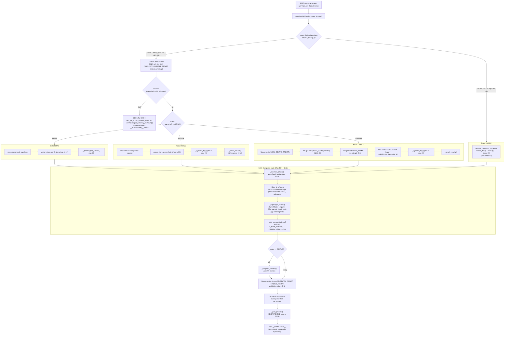
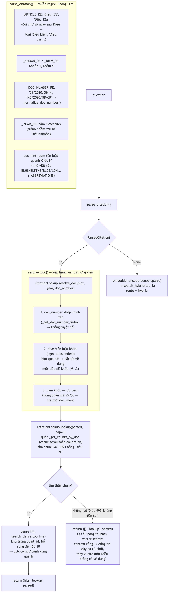
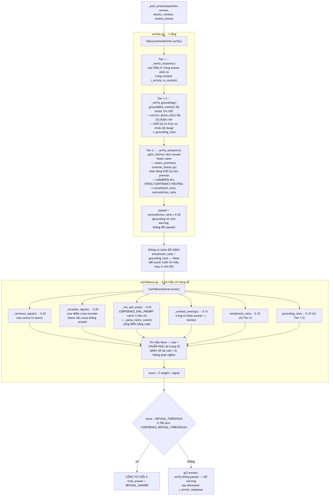
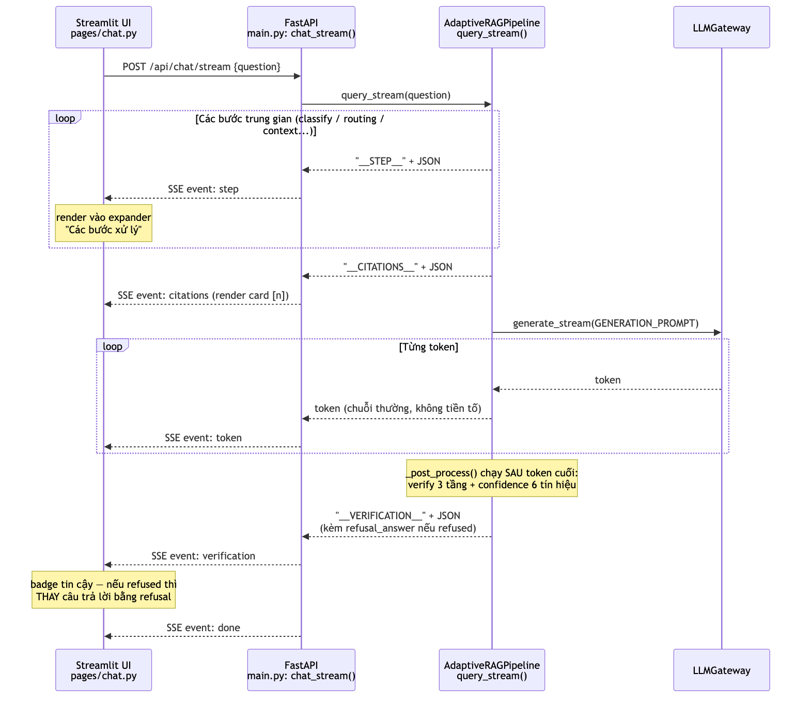
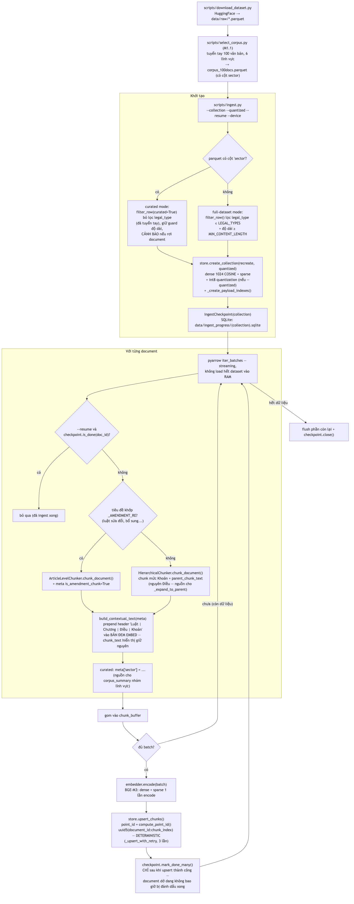

# Workflow chính — chi tiết đến mức hàm

Tài liệu này vẽ lại các luồng chạy chính của hệ thống bằng sơ đồ, **đúng theo trình tự
gọi hàm trong code** — mỗi node ghi tên hàm + file để đối chiếu trực tiếp.
Đọc kèm [`ARCHITECTURE.md`](ARCHITECTURE.md) (bản đồ module + lý do thiết kế).

Nguồn Mermaid của từng sơ đồ nằm ở [`diagrams/*.mmd`](diagrams/); ảnh PNG được render
sẵn bằng mermaid-cli. Khi sửa `.mmd`, render lại bằng:

```bash
mmdc -i docs/diagrams/<tên>.mmd -o docs/diagrams/<tên>.png -s 2 -b white
```

Các workflow:

1. [Luồng online — `query_stream()`](#1-luồng-online--adaptiveragpipelinequery_stream) (luồng chính, đọc đầu tiên)
2. [Route trích dẫn — `retrieve_routed()`](#2-route-trích-dẫn--retrieve_routed)
3. [Hậu kiểm — `_post_process()`: verify + confidence](#3-hậu-kiểm--_post_process-verify--confidence)
4. [Giao thức streaming UI ↔ backend](#4-giao-thức-streaming-ui--backend)
5. [Luồng offline — `scripts/ingest.py`](#5-luồng-offline--scriptsingestpy)

---

## 1. Luồng online — `AdaptiveRAGPipeline.query_stream()`

File: `src/rag/orchestrator.py`. Luồng non-streaming `query()` giống hệt về thứ tự hàm,
chỉ khác không yield marker trung gian. (`NaiveRAGPipeline.query()` baseline là bản rút
gọn: `search_dense` → annotate/filter/expand → build context → generate, **không** có
cổng nào.)



*Nguồn: [`diagrams/01-query-stream.mmd`](diagrams/01-query-stream.mmd)*

Lưu ý so với code (thứ tự chính xác trong `query_stream()`):

- Với route simple/medium/complex, `_annotate_phase2` + `_filter_in_effect` chạy **ngay
  sau search, trước** `_dynamic_top_k`/rerank (để chunk hết hiệu lực không chiếm slot);
  `_expand_to_parent` chạy sau cùng, ngay trước build context. Sơ đồ gộp chúng vào một
  khối cho gọn.
- Route lookup **không** qua `_dynamic_top_k`/rerank — `retrieve_routed` đã cap 10 kết quả.
- Câu trích dẫn bỏ qua hoàn toàn `_classify_and_scope` (tiết kiệm 1 LLM call, và câu
  "Điều N..." hiển nhiên in-scope nếu tra được).

Số LLM call mỗi route (không tính self-eval trong hậu kiểm): lookup 1 (generate),
simple/medium 2 (classify + generate), complex 5 (classify + rewrite + multi-query +
HyDE + generate, thêm 1 nếu compress).

---

## 2. Route trích dẫn — `retrieve_routed()`

File: `src/rag/citation_lookup.py`. Được dùng chung bởi orchestrator **và** chế độ eval
`routed` trong `scripts/eval.py` — hai nơi đo/dùng cùng một logic.



*Nguồn: [`diagrams/02-citation-route.mmd`](diagrams/02-citation-route.mmd)*

Cache (`_load_collection_cache`) scroll toàn collection một lần và giữ 3 index trong
RAM: alias → title, doc_number chuẩn hoá → doc_id, doc_id → chunks. `corpus_summary()`
(nhóm theo `sector` cho scope gate) và `corpus_summary_compact()` (câu từ chối) cũng
dựng từ đúng cache này — mọi thứ cùng nhìn một nguồn sự thật.

---

## 3. Hậu kiểm — `_post_process()`: verify + confidence

Files: `src/rag/orchestrator.py` (`_post_process`), `verifier.py`, `confidence.py`,
`context_blocks.py`. Chạy **sau khi** token cuối đã stream về UI — không làm chậm token
đầu, nhưng có thể "rút lại" câu trả lời.



*Nguồn: [`diagrams/03-post-process.mmd`](diagrams/03-post-process.mmd)*

Hai quy ước dễ trượt khi đọc code:

- **None ≠ 0.0**: `entailment_ratio=None` nghĩa là "không có claim nào để chấm" (tín
  hiệu bị loại + chuẩn hoá lại trọng số); `0.0` nghĩa là "có claim và tất cả đều fail".
  Nhầm hai giá trị này sẽ phạt oan các câu trả lời ngắn.
- **`passed` chỉ phụ thuộc contradiction**: grounding/citation lỗi chỉ sinh warning.
  Ngưỡng từ chối 0.700 được calibrate trên hành vi đó — đổi `passed` là phải
  recalibrate.

---

## 4. Giao thức streaming UI ↔ backend

Files: `src/ui/pages/chat.py` → `src/api/main.py: chat_stream()` →
`src/rag/orchestrator.py: query_stream()`.



*Nguồn: [`diagrams/04-streaming-protocol.mmd`](diagrams/04-streaming-protocol.mmd)*

`chat_stream()` phân loại từng chunk theo tiền tố (`__STEP__` / `__CITATIONS__` /
`__VERIFICATION__`, còn lại là token) và có fallback: pipeline chết giữa chừng mà chưa
kịp phát `__VERIFICATION__` thì API vẫn đóng stream bằng event `done` với giá trị mặc
định — UI không bao giờ treo.

---

## 5. Luồng offline — `scripts/ingest.py`

Chạy local (CPU) hoặc Kaggle GPU (xem
[`notes/kaggle-ingest-guide.md`](notes/kaggle-ingest-guide.md)).



*Nguồn: [`diagrams/05-ingest.mmd`](diagrams/05-ingest.mmd)*

Bất biến quan trọng của luồng này:

- **Chạy lại luôn an toàn**: point ID deterministic nên ingest lại (kể cả không
  `--resume`) không tạo point trùng — checkpoint chỉ để tiết kiệm thời gian embed
  (GPU-hour Kaggle), không phải cơ chế đảm bảo đúng đắn.
- **Checkpoint ghi sau upsert**: document chỉ được `mark_done_many` sau khi flush thành
  công, nên rớt session giữa chừng → chạy lại với `--resume` sẽ làm lại đúng phần dở.
- **`--quantized` phải bật ngay lần tạo collection đầu** — quantization chỉ áp khi
  `create_collection` tạo mới.

Enrichment (graph/timeline/amendment) là luồng offline **riêng** — `POST
/api/pipeline/enrich` → `PipelineEnricher` → ghi `data/metadata/` (không đụng Qdrant);
kết quả được luồng online đọc qua `get_phase2_status()` ở bước `_annotate_phase2` /
`_filter_in_effect` (workflow 1).
